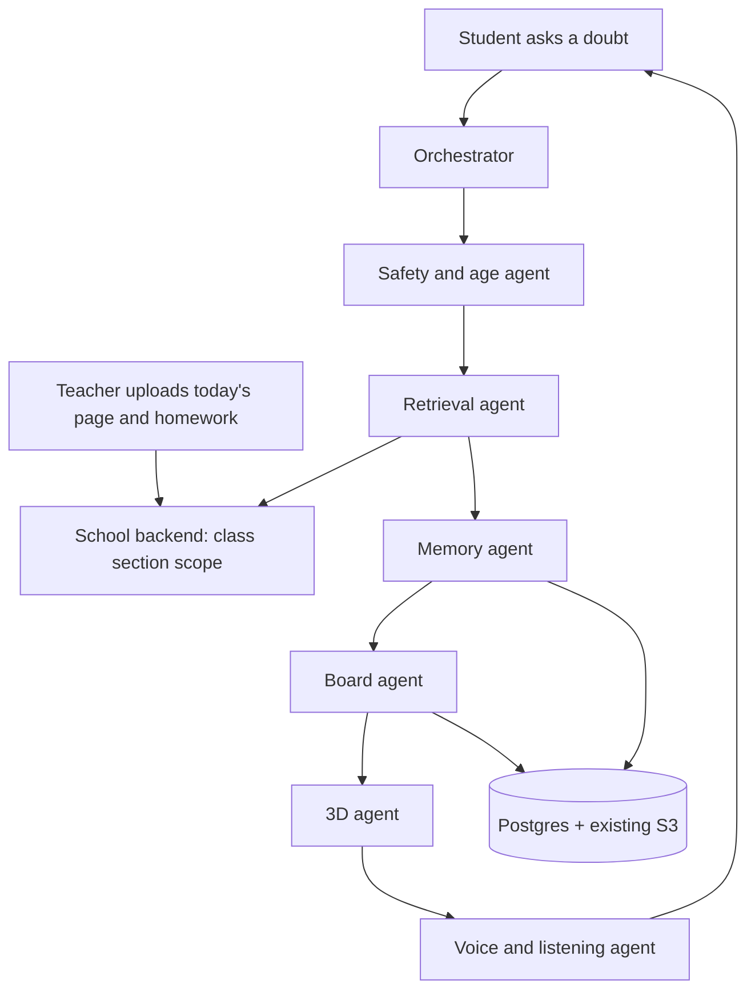

# AI teacher architecture

How a class in India uses Sybeez after one school day: the teacher uploads the page they taught and that class's homework. Only that class can see it. Students ask the AI teacher about that page. The teacher explains on a board, saves every board as a picture, and moves to a 3D model only when one really matches.

Students see **AI teacher**. Every other role sees **AI assistant**. This document is the contract for the AI service, the school backend, and the website.

## Picture of the system



The orchestrator does not call six models. Safety, retrieval against today's page, board layout, 3D choice, and memory notes are ordinary code. **One** language-model call writes the spoken explanation, and only after safety has allowed it and today's page is loaded. If the model is down, the explanation is built from the uploaded sentences. That keeps the existing daily caps and the $100/month AWS budget.

## What each agent does

| Agent | Job | Spends a model call? |
| --- | --- | --- |
| Orchestrator | Runs the others in order. Stops early on a refusal or a clarifying question. | No |
| Safety and age | Blocks harmful requests. Redirects games and gossip back to class. Uses the existing school-safety rules. | No |
| Retrieval | Loads **only** the caller's class section for the date. Quotes the teacher's text. If the doubt is not on that page, asks which part they mean instead of inventing a syllabus. | No |
| Memory | Reads and writes three layers: this session, this student, this class. | No |
| Board | Three short steps. Each step is a heading, a few words on the board, and speech. Before the board is wiped for the next step, the step is saved as a snapshot the website turns into a picture. | Uses the one explanation call |
| 3D | If the topic has its own model, send labelled hotspots ("this is the leaf"). Otherwise say 3D is not available. Never reuse another topic's model. | No |
| Voice and listening | The browser already talks to Gemini Live. The orchestrator tells it: wait for the student, stop when they interrupt, ask one question when unsure, stay on today's page. | Voice session caps already exist |

## Who can see a day's teaching

The school backend is the authority. The AI service sends the caller's own login token. It never decides class membership by itself.

| Person | See today's page and homework | Ask the AI teacher | See saved board pictures |
| --- | --- | --- | --- |
| Teacher of that class section | Upload and read | No. They use the **AI assistant**. | Read for their class |
| Student in that section | Read | Yes | Their own pictures |
| Parent linked to a student in that section | Read | No. They use the **AI assistant**. | Their child's pictures |
| Anyone else, including another section of class 6 | No | No | No |

## Backend contract

Base path `/api/v1/classroom`. Same bearer token as the rest of the school API. School id comes from the token. A missing route may return 404 until this is deployed. The AI service then says it cannot see today's page, and does not invent one.

### Upload today's page — teacher only

`POST /api/v1/classroom/today`

```json
{
  "class_section_id": "uuid",
  "on": "2026-11-11",
  "subject": "Science",
  "topic": "Photosynthesis",
  "page_ref": "Science textbook, page 42",
  "taught": "Plants make food using sunlight, water and air. The leaf is where this happens.",
  "homework": "Draw a leaf and label sunlight, water and air."
}
```

`taught` and `homework` are each at most 4000 characters. The backend stores one row per school, class section, and date. A second upload on the same day replaces the text. It does not delete other days.

Response `201`:

```json
{
  "id": "uuid",
  "class_section_id": "uuid",
  "on": "2026-11-11",
  "topic": "Photosynthesis"
}
```

`403` if the caller is not a teacher of that section. `400` if the text is empty.

### Read today's page — that class only

`GET /api/v1/classroom/today?class_section_id={uuid}&on=2026-11-11`

`on` defaults to the school's local date. Response `200`:

```json
{
  "id": "uuid",
  "class_section_id": "uuid",
  "class_label": "6A",
  "on": "2026-11-11",
  "subject": "Science",
  "topic": "Photosynthesis",
  "page_ref": "Science textbook, page 42",
  "taught": "Plants make food using sunlight, water and air.",
  "homework": "Draw a leaf and label sunlight, water and air.",
  "chunks": [
    {"id": "uuid", "source": "Today's class", "text": "Plants make food using sunlight, water and air."},
    {"id": "uuid", "source": "Homework", "text": "Draw a leaf and label sunlight, water and air."}
  ]
}
```

If nothing was uploaded, `200` with `"chunks": []` and empty strings. `403` for every other class section, unlinked parent, or other school.

### Save a board picture

`POST /api/v1/classroom/board-pictures`

The AI service sends the snapshot (the drawing instructions). The website renders that snapshot to a PNG and uploads it with the second call. Both are kept. Nothing is deleted when the board is wiped.

```json
{
  "student_user_id": "uuid",
  "class_section_id": "uuid",
  "on": "2026-11-11",
  "topic": "Photosynthesis",
  "session_id": "uuid or null",
  "step_index": 0,
  "caption": "Sunlight, water and air",
  "snapshot": {"heading": "Photosynthesis", "lines": ["Sun + water + air"]}
}
```

Response `201`: `{"id": "uuid"}`.

`PUT /api/v1/classroom/board-pictures/{id}/image` with `multipart` file `image` (PNG, at most 1 MB). Store the file in the **existing** S3 bucket. Response `200`: `{"id": "uuid", "image_url": "https://..."}`.

`GET /api/v1/classroom/board-pictures?student_user_id={uuid}&on=2026-11-11`

Students see themselves. Parents see a linked child. The class teacher sees students in that section. Response `200`: a list of `{id, on, topic, step_index, caption, snapshot, image_url}`.

### Memory

Three tables, all scoped by `school_id`. No cross-school reads.

Student memory — the student, a linked parent (read only), or the class teacher:

`GET /api/v1/classroom/memory/student?student_user_id={uuid}`

`POST /api/v1/classroom/memory/student`

```json
{
  "student_user_id": "uuid",
  "class_section_id": "uuid",
  "kind": "doubt",
  "concept": "Photosynthesis",
  "note": "Asked how a leaf makes food",
  "on": "2026-11-11"
}
```

`kind` is one of `doubt`, `misconception`, `mastery`, `style`. At most 20 notes returned, newest first.

Class memory — teacher of that section only. No student names in `note`.

`GET /api/v1/classroom/memory/class?class_section_id={uuid}`

`POST /api/v1/classroom/memory/class`

```json
{
  "class_section_id": "uuid",
  "kind": "common_doubt",
  "concept": "Photosynthesis",
  "note": "Several students are unsure what the leaf uses to make food",
  "on": "2026-11-11"
}
```

Session memory stays in the browser and is sent back on the next AI turn. It is not a new database.

## AI service contract

`POST /api/v1/ai/classroom/turn`

Students only. Other roles receive `403`. The call counts toward the existing daily model cap.

```json
{
  "message": "How does the leaf make food?",
  "class_section_id": "uuid",
  "on": "2026-11-11",
  "session_id": null,
  "session_memory": ["Student asked about the leaf"]
}
```

`message` is 1 to 2000 characters. `session_memory` is at most 8 strings of 200 characters.

Response `200`:

```json
{
  "persona": "AI teacher",
  "topic": "Photosynthesis",
  "grounded": true,
  "citations": [
    {"source": "Today's class", "quote": "Plants make food using sunlight, water and air."}
  ],
  "clarify": null,
  "speech": "Today your teacher taught that plants make food using sunlight, water and air. The leaf is where this happens. Can you name one thing the leaf uses?",
  "board": {
    "heading": "Photosynthesis",
    "wipe_after_step": true,
    "steps": [
      {
        "step_index": 0,
        "board_label": "Sun + water + air",
        "speech": "The leaf uses sunlight, water and air.",
        "snapshot": {"heading": "Photosynthesis", "lines": ["Sun + water + air"]}
      }
    ]
  },
  "scene3d": {
    "status": "unavailable",
    "model": null,
    "message": "3D not available for this topic",
    "hotspots": []
  },
  "memory_written": ["doubt:Photosynthesis"],
  "listening": {
    "barge_in": true,
    "end_of_turn_silence_ms": 700,
    "clarify_when_unsure": true,
    "max_listen_seconds": 20
  }
}
```

`grounded` is true only when a citation is a quote from today's upload. `clarify` is a question when the doubt is not on that page. The speech then does not pretend to teach a different chapter. `scene3d.status` is `ready` only when this topic has its own model. Hotspots use `x` and `y` from 0 to 1 and a `say` line that starts with "This is the".

The website draws each `snapshot`, exports a PNG, and calls the board-picture upload. Then it wipes the board and draws the next step.

## Storage and cost

Reuse only what is already paid for.

| Need | Where | New AWS service? |
| --- | --- | --- |
| Today's page, memory, picture rows | Existing Postgres | No |
| Optional similarity on older pages | Existing pgvector, later | No |
| PNG files | Existing S3 bucket, private, class-scoped key | No |
| Today's page cache for 60 seconds | Process memory, or existing Redis if it is already on | No |
| Speech model | Existing chat provider, one short call | No |
| Voice | Existing Gemini Live session, existing daily cap | No |
| 3D | three.js in the browser. No GPU server. | No |

A class of 40 students asking three doubts is about 120 short model calls, a few cents on the current cheap chat model, and about 120 small PNGs. Voice stays inside 8 sessions a student a day and 200 a school a day. This plan adds no always-on server and does not raise those caps.

## What is intentionally later

- Searching every textbook in the school. Version one is **today's uploaded page and homework** only.
- Automatic class-memory counts ("12 students asked this"). The teacher sees notes without student names. Counts can come after the table exists.
- The website rendering the PNG. The AI service stores the snapshot either way, so a picture can be rebuilt if the upload fails.
